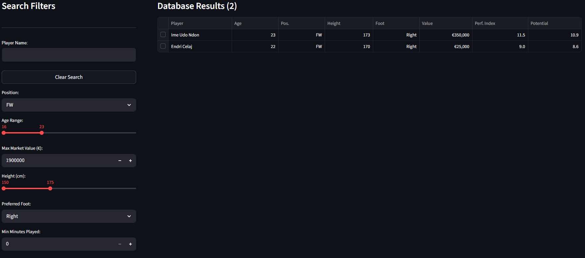
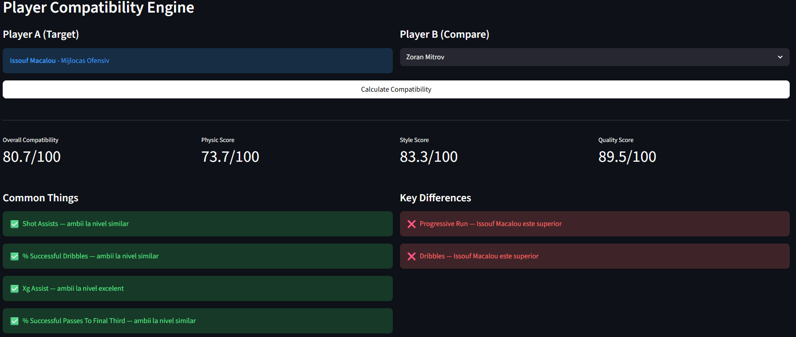

# U-Scout — Football Scouting Platform

A Streamlit scouting tool for the Romanian Superliga: search players with scouting filters,
rank them by a position-aware performance index, and compare two players with a
compatibility score built from physical, style and quality metrics.

Built in 48 hours at **U-Hack 2026** (April, Cluj-Napoca) by a team of five:
[@davidandrus1](https://github.com/davidandrus1), [@denisg203](https://github.com/denisg203),
[@sofiamaiabud9](https://github.com/sofiamaiabud9), [@radumihacea](https://github.com/radumihacea)
and [@tiracatalin](https://github.com/tiracatalin).
Forked from [davidandrus1/CodeInBlackWite](https://github.com/davidandrus1/CodeInBlackWite).

<!-- TODO: capturi de ecran -->



## Features

**Search database**
- Filters by name, age, position, market value, height, preferred foot and minutes played
- Per-90 and percentage metrics computed from match-level statistics
- AI scouting insights generated with Gemini from a player's statistical profile

**Current squad**
- Squad overview with a *Growth Potential* index: per-position performance relative to the league
  average, weighted by age
- Replacement suggestions within a budget

**Player compatibility engine**
Compares two players at the same position and returns a 0–100 score from three components:

| Component | Method | What it captures |
|---|---|---|
| Physical | Gaussian similarity on height and weight | Body profile |
| Style | Pearson correlation of normalized stats | *How* a player plays |
| Quality | Weighted Euclidean distance | *How well* a player performs |

Each of the 8 positions (goalkeeper, centre-back, full-back, defensive / central / attacking midfielder,
winger, striker) uses its own feature set — e.g. goalkeepers are judged on saves and xG prevented,
strikers on xG, shot accuracy and conversion. The result includes a radar chart and an automatic
list of similarities and differences.

## My contributions

- Player compatibility engine: position-specific feature sets and the three-component similarity score
  (`models/feature_engineering.py`, `models/similarity.py`)
- Player filtering logic and the squad tab — see commit
  [`949a8d9`](https://github.com/davidandrus1/CodeInBlackWite/commit/949a8d9df779bca3f5592e2157555863c9e36c16)
- Design of the Gemini scouting assistant (prompting from statistical profiles)

During the hackathon code was pushed from two shared laptops, so commit authorship does not fully
reflect individual contributions.

## Data

The original app used licensed **Wyscout** match data provided by the hackathon organizers.
That data is **not included** in this repository. Market values come from the public
Transfermarkt dataset (`players.csv`).

<!-- TODO: dupa ce adaugam date demo, explica aici cum se ruleaza cu ele -->

## Running locally

```bash
pip install -r requirements.txt
streamlit run app.py
```

For AI insights, set a Gemini API key:

```bash
# Linux / macOS
export API_KEY="your-key"
# Windows PowerShell
$env:API_KEY="your-key"
```

## Tech stack

Python · Streamlit · pandas · NumPy · SciPy · scikit-learn · Plotly · Google Gemini API
